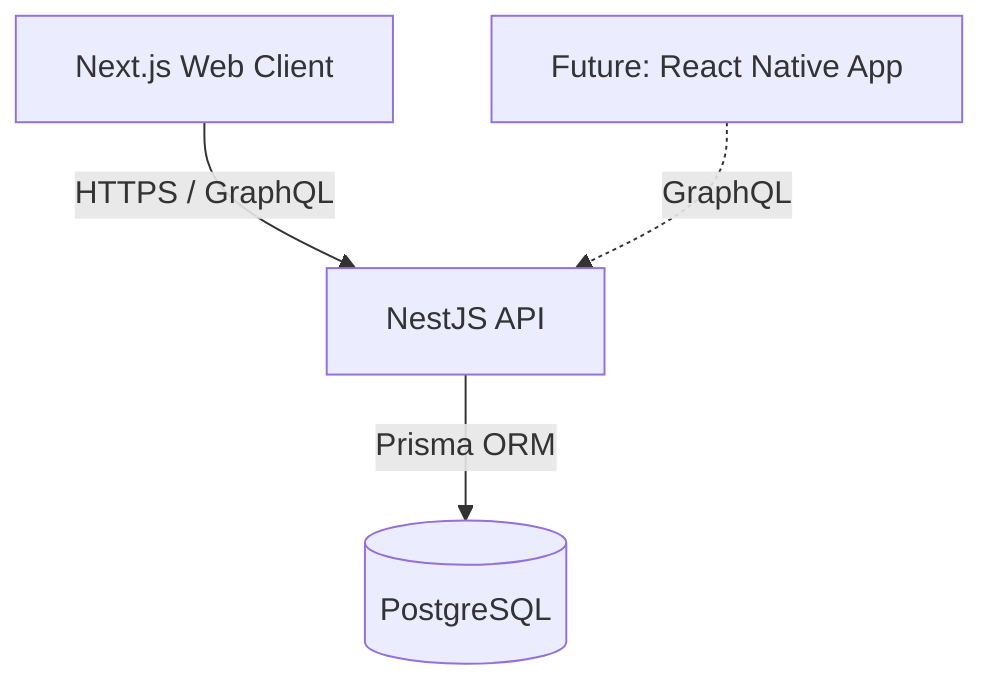
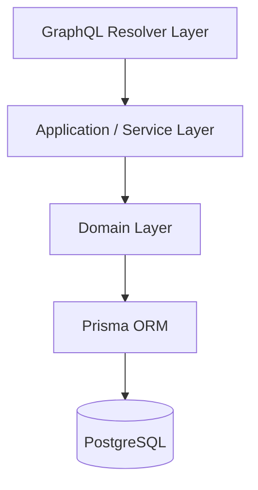

# GymFlow

<!-- atlas:início -->
<!-- gerado a partir de storm-atlas/projects/gym-flow.md — não editar à mão -->

> App de treino que trata os planos como planos — preparar, executar e ler a consistência, com API GraphQL própria.

## O que é

Uma aplicação de registo de treino construída como sistema, e não como lista de exercícios: uma
biblioteca de treinos, sessões executadas, séries registadas e a leitura da consistência e do volume
ao longo do tempo. O backend é uma API GraphQL em NestJS que é a fonte única de verdade; o cliente
web em Next.js é fino de propósito, para que um cliente móvel futuro reutilize tudo o que já existe.

## Por que existe

O Anderson treina com constância e queria uma coisa que usasse de verdade — e que servisse ao mesmo
tempo de campo de provas para arquitetura limpa desde o primeiro dia, em vez do habitual "depois
arruma-se". O `PRODUCT.md` é explícito quanto ao alvo: a clareza de performance do Strava e do Whoop
**sem** virar feed desportivo ruidoso nem dashboard genérico de SaaS. Móvel para executar rápido no
ginásio; desktop para preparar e compreender.

## O que faz

- **Autenticação com JWT próprio**, com guards e strategies em NestJS
- **Recuperação de password ponta a ponta** — token, email transacional por Resend, e páginas de
  esquecer e repor password no cliente
- **Biblioteca de exercícios** com CRUD
- **Treinos (workouts)** compostos por exercícios, com agendamento (`WorkoutSchedule`)
- **Sessões de treino** com estado (`WorkoutSessionStatus`), exercícios da sessão e séries registadas
- **Internacionalização** no cliente web, com rotas por locale (`app/[locale]`)
- **PWA** com manifest e tratamento de safe-area insets para ecrãs com notch
- **Versionamento e releases automatizados** — semver centralizado, sincronização de versões entre
  pacotes e workflow de release que dispara o deploy hook

## Como funciona

- Monorepo pnpm com `apps/api` e `apps/web`, mais `packages/` reservado
- **Arquitetura API-first:** o backend é a fonte única de verdade e a lógica de negócio nunca desce
  para o cliente. Foi decisão tomada à partida para o cliente React Native futuro não obrigar a
  reescrever domínio
- Backend em camadas explícitas: resolvers GraphQL → serviços → domínio → Prisma → PostgreSQL
- Cliente Next.js com App Router e React Server Components; fala GraphQL com a API por um proxy
  (`src/proxy.ts`) para o token não circular no browser
- Deploy da API por blueprint de Render com `autoDeployTrigger: "off"` — publica-se **só** por deploy
  hook a partir do workflow de release, nunca por push
- O CI teve de aprender a correr `prisma generate` antes do lint e do validate, senão os tipos
  gerados não existiam ainda

## Estado atual

Pausado desde 2026-04-13, na versão 1.0.4. **O `README.md` está desatualizado** — diz "integração de
base de dados em curso, autenticação a seguir", mas a autenticação está feita, incluindo o fluxo
completo de reposição de password com email, e a base de dados tem nove modelos em Prisma. O último
commit normaliza o `MAIL_FROM` para validação de remetente no Resend.

Existe, portanto: auth, exercícios, treinos, agendamento, sessões e séries, i18n e PWA. Não existe
ainda: a app React Native (prevista na arquitetura, `apps/` só tem `web` e `api`) e a leitura de
padrões de treino que o `PRODUCT.md` descreve como o valor central do desktop.

<!-- atlas:fim -->

GymFlow is a workout tracking application built to manage training sessions, progression, and performance metrics in a structured and scalable way.

The goal is to build something I can personally use and validate with real feedback — focusing on clean architecture and long-term maintainability from day one.

## 🚀 Project Status

Early stage.

- Architecture defined
- Frontend and backend setup completed
- Database integration in progress
- Authentication coming next

## 🏗️ System Architecture

GymFlow follows an API-first architecture where the backend acts as the single source of truth.

Frontend and backend are fully separated to keep business logic isolated in the API layer.

Current structure:



This separation allows:

- Clear responsibility boundaries
- Easier domain evolution
- Future support for additional clients (e.g. mobile)

## 🧠 Backend Architecture

The backend follows a layered structure to isolate responsibilities and keep domain logic independent from infrastructure concerns.



## 🛠️ Tech Stack

### Frontend

- Next.js (App Router)
- React Server Components
- GraphQL Client

### Backend

- NestJS
- Apollo GraphQL
- Prisma ORM
- Custom JWT authentication (in progress)

### Database

- PostgreSQL (hosted on Supabase)

### First-time database setup (base exercises)

After applying Prisma migrations, run the seed to create or update system exercises (`isSystem: true`) that every user sees in the exercise library:

```bash
pnpm --filter @gymflow/api db:migrate:dev
pnpm db:seed
```

The seed is idempotent (uses `upsert` with stable ids, e.g. `ex-1` … `ex-10`).

## 🎯 Why This Stack?

The project is intentionally structured to:

- Keep business logic inside the API layer
- Avoid frontend-driven data modeling
- Enable flexible data fetching through GraphQL
- Maintain strong type safety across layers

The focus is not on speed alone, but on building a foundation that won't require architectural rewrites as the project evolves.

## 🔐 Authentication Strategy

Authentication will be implemented using a custom JWT-based approach instead of relying on Supabase Auth.

The goal is to:

- Control token lifecycle
- Implement access + refresh token strategy
- Keep auth logic inside the API boundary

## 📦 Future Considerations

- Workout domain modeling
- Session history and progression tracking
- Role-based access (if needed)
- Potential mobile client

## 🧠 Philosophy

GymFlow is being built as a real-world system — not just a demo project.

The emphasis is on:

- Clear boundaries
- Explicit domain modeling
- Scalable backend structure
- Iterative improvement based on real usage

## 📌 Disclaimer

This project is under active development and architectural decisions may evolve as the domain becomes clearer.
